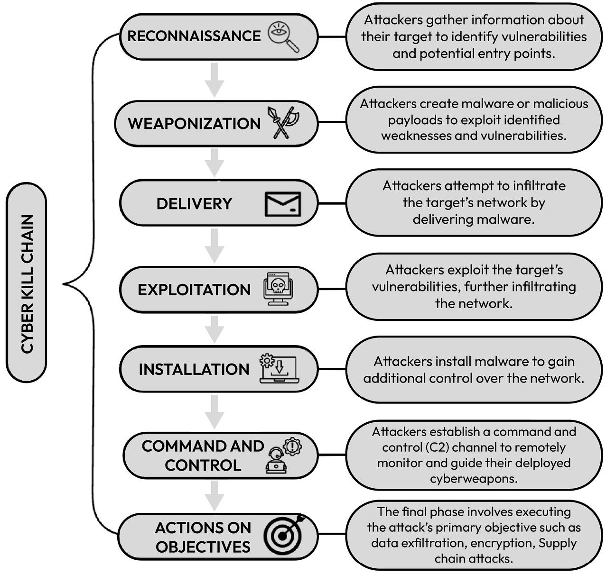

# Cyber Kill Chain Framework

## Overview

The Cyber Kill Chain is a cybersecurity framework developed by Lockheed Martin to describe the stages an attacker may follow during a cyberattack.

It helps security professionals understand attacker behavior, identify opportunities for detection, and determine where defensive controls can disrupt an attack.

## The Seven Stages

### 1. Reconnaissance

**Purpose:** Gather information about the target.

Attackers may identify employees, exposed systems, domains, and potential vulnerabilities.

**Defensive focus:** Monitor suspicious scanning, investigate unusual reconnaissance activity, and reduce unnecessary exposure of sensitive information.

### 2. Weaponization

**Purpose:** Prepare a malicious payload or exploit for the intended target.

An attacker may combine malware with an exploit or prepare a malicious document.

**Defensive focus:** Use threat intelligence, endpoint protection, and malware analysis to identify potential threats.

### 3. Delivery

**Purpose:** Transmit the malicious payload to the target.

Common delivery methods include phishing emails, malicious attachments, compromised websites, and infected downloads.

**Defensive focus:** Use email security, web filtering, attachment scanning, and user awareness training.

### 4. Exploitation

**Purpose:** Trigger a vulnerability or exploit a weakness to gain unauthorized access or execute malicious code.

This may involve exploiting vulnerable software or manipulating a user into executing malicious content.

**Defensive focus:** Apply security patches, monitor suspicious process execution, and investigate endpoint alerts.

### 5. Installation

**Purpose:** Establish malware or another mechanism on the compromised system to maintain access.

An attacker may attempt to establish persistence so access survives a reboot or user logout.

**Defensive focus:** Monitor persistence mechanisms, unexpected software installations, and unauthorized system changes.

### 6. Command and Control (C2)

**Purpose:** Establish communication between compromised systems and attacker-controlled infrastructure.

This communication may allow attackers to issue commands and manage compromised devices.

**Defensive focus:** Investigate suspicious outbound connections, unusual DNS requests, and communication with known malicious infrastructure.

### 7. Actions on Objectives

**Purpose:** Achieve the attacker's goal.

Possible objectives include data theft, credential theft, disruption, espionage, or ransomware deployment.

**Defensive focus:** Monitor unusual data transfers, unauthorized access to sensitive resources, suspicious account activity, and signs of data exfiltration.

## Practical Example: Phishing Attack

Consider an employee who receives an email impersonating a trusted organization.

1. **Reconnaissance:** The attacker gathers information about the organization and its employees.
2. **Weaponization:** The attacker prepares a malicious attachment or payload.
3. **Delivery:** The phishing email reaches the employee.
4. **Exploitation:** The employee opens the attachment, triggering malicious code execution.
5. **Installation:** Malware establishes a foothold on the system.
6. **Command and Control:** The compromised system communicates with attacker-controlled infrastructure.
7. **Actions on Objectives:** The attacker attempts to steal sensitive information or deploy ransomware.

This is an illustrative scenario. Real attacks may skip stages, repeat them, or follow a different sequence.

## How SOC Analysts Use the Framework

SOC analysts can use the Cyber Kill Chain to:

* Organize threat intelligence and investigation findings.
* Map observed activity to possible stages of an attack.
* Identify opportunities to detect or disrupt malicious activity.
* Correlate endpoint, network, email, and authentication evidence.
* Communicate an incident's progress to other security teams.

The framework provides a useful high-level model, but it does not describe every possible attack technique. Analysts should also use other resources, such as the MITRE ATT&CK framework, when more detailed technique-level analysis is needed.

## Key Takeaway

The Cyber Kill Chain helps defenders think beyond an individual alert and consider how suspicious activity may fit into a broader attack.

The practical value is identifying where an attack can be detected, investigated, and disrupted.

## Learning Outcome

I studied the seven stages of the Cyber Kill Chain and how they relate to phishing, malware delivery, persistence, command-and-control communication, and attacker objectives.

My next step is to connect these stages with practical security monitoring, log analysis, and incident investigation exercises.

## References

* Lockheed Martin: Cyber Kill Chain framework
* MITRE ATT&CK: Enterprise adversary tactics and techniques

---

*This document is for cybersecurity learning and defensive security analysis.*

## Visual Overview

